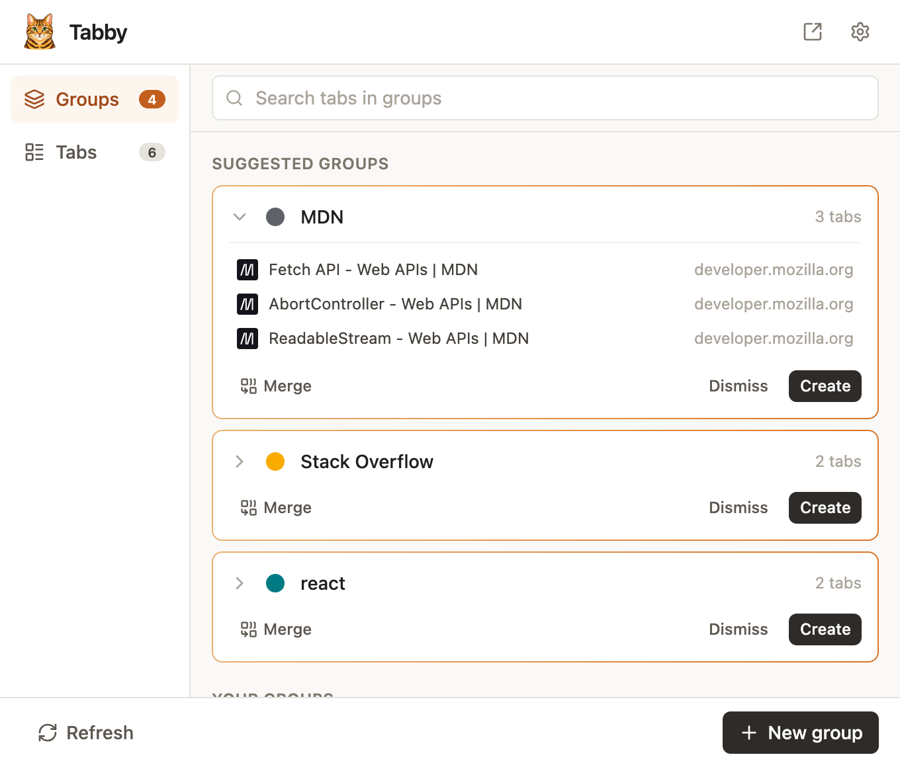
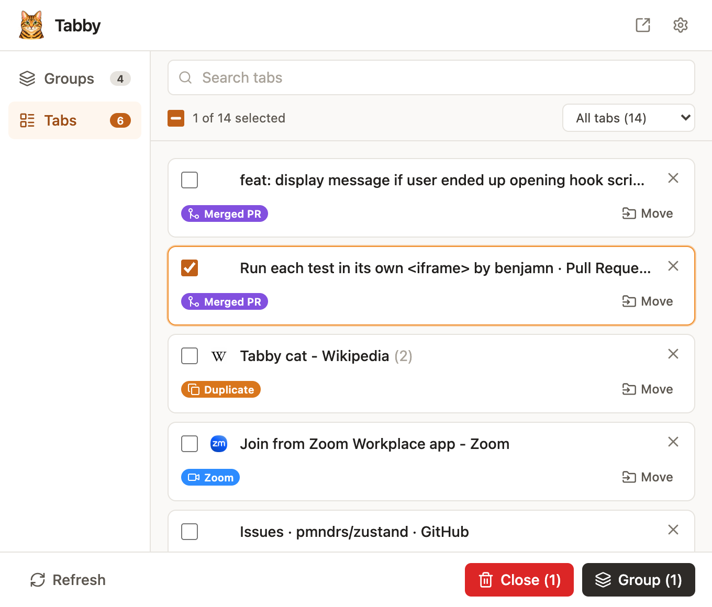
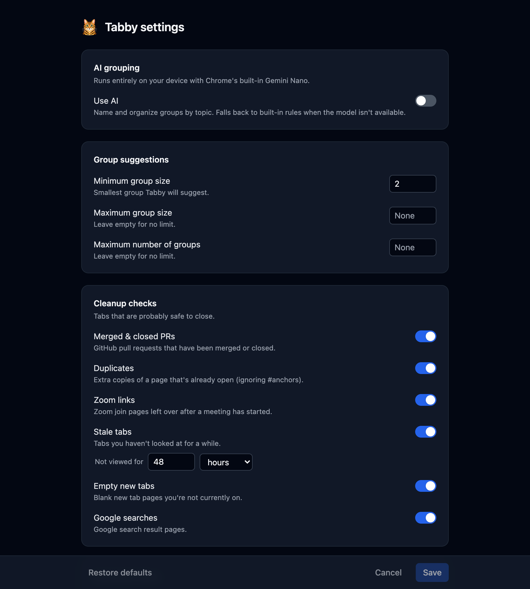

# Tabby

Tabby is a Chrome extension that suggests tab groups and flags tabs that are safe to close. Everything runs on your device. There are no accounts, API keys or servers.

## Screenshots

<table>
  <tr>
    <td width="50%">
      <picture>
        <source media="(prefers-color-scheme: dark)" srcset="docs/screenshots/groups-dark.png">
        
      </picture>
    </td>
    <td width="50%">
      <picture>
        <source media="(prefers-color-scheme: dark)" srcset="docs/screenshots/tabs-dark.png">
        
      </picture>
    </td>
  </tr>
  <tr>
    <td align="center"><b>Groups</b>: suggested groups you can rename, recolor, merge or create in one click</td>
    <td align="center"><b>Tabs</b>: every tab, with badges for the ones that are safe to close</td>
  </tr>
</table>

<p align="center">
  
</p>

## Features

- **Group suggestions.** Built-in rules recognize common services (Google Docs, Sheets, Slides, Forms, Drive, Gmail, Calendar and Meet, plus Stack Overflow, MDN, npm, Notion, Linear, Figma, Confluence, Jira, Slack, YouTube and Spotify) and GitHub orgs and repos, then suggest a named, colored group for each.
- **On-device AI grouping (optional).** Chrome's built-in Gemini Nano groups tabs by topic and names the groups. You can add custom instructions. When the model isn't available, Tabby falls back to the rules.
- **Stable suggestions.** Suggestions keep their name, color and order across refreshes. When new tabs fit an existing suggestion, they join it. Dismiss a suggestion to have it regrouped.
- **Existing-group actions.** Tabby suggests adding matching ungrouped tabs to a group, and merging groups that cover the same thing. You can also ungroup, delete, merge and rename groups, and add or remove individual tabs in both groups and suggestions.
- **Cleanup checks.** Each check has its own toggle:
  - GitHub pull requests that are merged or closed. The state is read live from the page and cached by a content script.
  - Duplicate tabs (the `#hash` is ignored)
  - Leftover Zoom join pages
  - Empty new tabs
  - Google search result pages
  - Stale tabs that you haven't viewed for a configurable time (48 hours by default)
- **Tabs view.** Every tab is listed in one place, with cleanup badges, search, filters, bulk Close and Group, and a Move menu. Duplicate tabs collapse into a single card.
- **Toolbar badge.** The badge shows how many suggestions are waiting.
- **Appearance.** Choose light, dark or system (follows your computer's setting) on the settings page.

## Installation

### From a GitHub release

1. Download the `.zip` file from the [latest release](https://github.com/mattfurtado/tabby/releases/latest) and unzip it.
2. Open `chrome://extensions` and turn on **Developer mode**.
3. Click **Load unpacked** and select the unzipped folder.

Chrome doesn't update extensions loaded this way. To upgrade, download the new release and load it again.

### From the Chrome Web Store

Open [Tabby on the Chrome Web Store](https://chromewebstore.google.com/detail/tabby/aeijnnlikijfdcphmidkikpebfpiedjc) and click **Add to Chrome**. Chrome keeps it up to date.

### From source

Requirements: Node 20+ and pnpm.

1. Clone the repo, or download it from GitHub with **Code > Download ZIP** and unzip it.
2. Install the dependencies and build:

   ```sh
   pnpm install
   pnpm build
   ```

3. Open `chrome://extensions` and turn on **Developer mode**.
4. Click **Load unpacked** and select the `build/chrome-mv3-prod` folder.

After pulling new changes, run `pnpm build` again and click the reload button on Tabby's card in `chrome://extensions`.

## Development

Requirements: Node 20+ and pnpm.

```sh
pnpm install
pnpm dev
```

Load the extension:

1. Open `chrome://extensions` and turn on **Developer mode**.
2. Click **Load unpacked** and select `build/chrome-mv3-dev`.
3. Pin Tabby and click its icon. To use Tabby as a full page, click the full-screen button in the popup header or go to `chrome-extension://<id>/tabs/fullscreen.html`.

Production build and zip:

```sh
pnpm build     # build/chrome-mv3-prod
pnpm package   # build/chrome-mv3-prod.zip
```

Typecheck with `npx tsc --noEmit`.

### Project layout

```
src/background.ts            service worker: analysis, badge, message handlers
src/popup.tsx                popup entry point
src/options.tsx              settings page entry point
src/tabs/fullscreen.tsx      full-page entry point
src/contents/pr-detector.ts  keeps GitHub PR states fresh in storage
src/core/                    pure logic and storage (heuristics, AI, reconcile, cleanup checks)
src/app/                     UI for the popup, full page and settings (App, Options, Zustand store, hooks, components)
assets/                      extension icons (Plasmo reads these from the project root)
```

Plasmo picks up entry points by file name inside `src/` (`popup.tsx`, `options.tsx`, `background.ts`, `contents/`, `tabs/`) and generates the manifest from them. The `~` import alias points to `src/`.

The service worker computes all suggestions and writes them to `chrome.storage.local`. The popup only subscribes to storage changes and reads live tab data. It never computes suggestions itself.

### Testing with the Chrome DevTools MCP

Because the popup also works as a normal page, you can drive it with the [Chrome DevTools MCP server](https://github.com/ChromeDevTools/chrome-devtools-mcp):

1. Start Chrome with Tabby loaded as an unpacked extension. Branded Chrome 137+ ignores `--load-extension`, so either load it through `chrome://extensions` in the MCP-controlled profile or use Chrome for Testing.
2. Open `chrome-extension://<id>/tabs/fullscreen.html` in a tab. You can find the id on `chrome://extensions`.
3. Use the MCP tools to take snapshots and screenshots, click, fill the search box and read console messages. Open some test tabs (several MDN pages, the same URL three times, a merged GitHub PR) so there's something to group and clean up.
4. To see analysis logs and check the AI model, inspect the service worker from `chrome://extensions` (click **service worker**).

## Gemini Nano (on-device AI)

Gemini Nano is Chrome's built-in on-device model. Tabby uses it through the Prompt API (`LanguageModel`). When the model is missing, Tabby falls back to its rules, so everything except AI naming keeps working.

### Requirements

- Desktop Chrome 138 or later (check `chrome://version`)
- Windows 10/11, macOS 13+ or Linux
- About 20 GB of free disk space on the volume that holds your Chrome profile
- A GPU with more than 4 GB of VRAM, or a CPU with at least 16 GB of RAM and 4 cores
- An unmetered connection for the one-time download

### Setup

1. In Chrome, open **Settings > AI Innovations** and turn on **On-device AI**. Turning it off later deletes the model files.
2. Open Tabby's **Settings**, turn on **Use AI** and check the **On-device AI model** status.
3. If the model isn't downloaded, click **Download**. This takes several minutes. If progress stays at 0%, open `chrome://components` and click **Check for update** on the on-device model entries. You can watch **Broker State** at `chrome://on-device-internals`.
4. When the status reads **Ready**, click **Refresh** in the popup.

If the model is unavailable on weaker hardware, try these flags in `chrome://flags`, then relaunch:

- `#prompt-api-for-gemini-nano`: **Enabled**
- `#optimization-guide-on-device-model`: **Enabled BypassPerfRequirement**

To check the status from the service worker console:

```js
await LanguageModel.availability({ expectedInputs: [{ type: "text", languages: ["en"] }], expectedOutputs: [{ type: "text", languages: ["en"] }] })
// "available" | "downloadable" | "downloading" | "unavailable"
```

On managed Chrome installs, enterprise policy may control the model. Flag names also change between Chrome versions.
